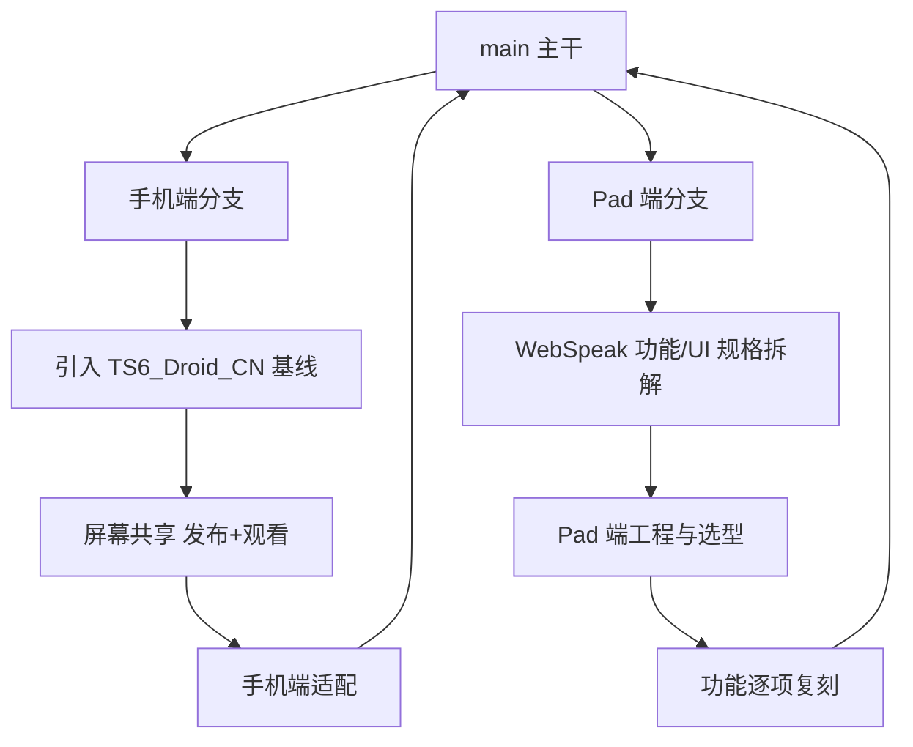

# 开发任务指令：TeamSpeak 6 For Android

> 本文件是本仓库的**主开发任务指令**（Task Brief），供 AI 编码代理（以及人类协作者）
> 理解项目背景、执行开发任务、判断任务完成标准。开始任何工作前请完整阅读本文件。

---

## 0. 项目背景

- 目标：打造一个功能完善、体验优秀的 **TeamSpeak（兼容 TS3 / TS6）Android 客户端**。
- 技术路线：基于两个成熟的开源项目进行开发，而非从零造轮子：
  1. **`YUAXI/TS6_Droid_CN`**（https://github.com/YUAXI/TS6_Droid_CN）
     —— TeamSpeak 3/6 的 Android 客户端，使用 Jetpack Compose 构建，
     由 `flamme-demon/TS6_Droid` 汉化并增强而来。**作为手机端开发基线。**
  2. **`EchoSixHIYA/WebSpeak-client-for-TeamSpeak`**（https://github.com/EchoSixHIYA/WebSpeak-client-for-TeamSpeak）
     —— 自托管 TeamSpeak Web 客户端 / 浏览器语音网关（TS3 + TS6，Opus 语音，
     支持跨平台 P2P 屏幕共享）。**作为 Pad 端 UI 与功能规格的参照标准。**
- 两端差异化适配：
  - **手机端（Phone）**：在现有开源客户端基础上，补齐缺失的核心互动功能——**屏幕共享（屏幕分享）及其观看**。
  - **Pad 端（Tablet）**：**全新开发**，完全复刻 Web 版（WebSpeak）的 **UI 界面** 与 **全部功能**，
    追求与 Web 端一致的完整体验。

### 最终目标

一个功能完善、体验优秀的 TeamSpeak 移动客户端：

- 手机端：在成熟基线上增强核心互动能力（屏幕共享等），保持轻量稳定；
- Pad 端：与 Web 端体验完全对齐的功能全集 + 大屏优化交互；
- 两端共享协议/音频等底层能力，长期可收敛为同一代码库的手机/平板分支形态。

---

## 1. 范围与边界

**纳入范围**

- TeamSpeak 3 / TS6 服务器的连接、语音、频道与用户管理、聊天等客户端核心功能；
- 屏幕共享：本机共享（发布端）与观看他人共享（订阅端）；
- 手机（竖屏/小屏）与 Pad（横屏/大屏）的差异化 UI 适配。

**暂不纳入范围**

- 服务端实现（直接对接现有 TS3 / TS6 服务器）；
- 服务器管理/运维类工具（如 ts6-manager 之类的管理面板）。

**必须先行验证的开放事项（见任务 A1 / B1）——2026-10-18 已核清：**

- ✅ 屏幕共享协议形态已确认：TS6 屏幕共享 = **客户端协议命令**（`requeststreaminfo` /
  `setupstream` / `joinstreamrequest` / `streamsignaling` / `removeclientfromstream` /
  `stopstream`，由服务端中转 WebRTC 信令）+ P2P/TURN WebRTC 媒体。
  详见 `docs/B1-webspeak-spec.md` §4 与 `docs/A1-phone-baseline.md` §5。
- ✅ 许可证与合规已核清（phone=GPL-3.0、tslib=MIT/Apache-2.0、pad=AGPL-3.0-only、
  teamspeak-js=MIT），组合规则与仓库组织见 `docs/adr/0002-licensing-and-workspace.md`。
- ⚠️ 新增关键风险（详见 `docs/adr/0001-pad-approach.md`）：
  1. Android 任何 Web 内核均不支持 `getDisplayMedia` → 屏幕共享**发布端必须原生实现**（MediaProjection）；
  2. WebSpeak 安卓容器内嵌 Node 18.20.4，而其 TS SDK 要求 Node ≥22.12（官方自述连通性未验证）
     → Pad 路线的前提是先做运行时 spike。

---

## 2. 参考项目

| 项目 | 地址 | 在本任务中的角色 |
| --- | --- | --- |
| TS6_Droid_CN | https://github.com/YUAXI/TS6_Droid_CN | 手机端开发基线（Jetpack Compose，TS3/TS6 客户端） |
| WebSpeak-client-for-TeamSpeak | https://github.com/EchoSixHIYA/WebSpeak-client-for-TeamSpeak | Pad 端 UI 与功能参照标准（自托管 Web 客户端 / 网关） |

### 上游锁定版本（2026-10-18 引入，完整表见根 `README.md`）

| 目录 | 上游 | 分支 @ 提交 | 许可证 |
| --- | --- | --- | --- |
| `phone/` | YUAXI/TS6_Droid_CN | `main@e79dbf6f` | GPL-3.0 |
| `tslib/` | flamme-demon/tslib_multi | `main@9326ed26` | MIT OR Apache-2.0 |
| `pad/` | EchoSixHIYA/WebSpeak-client-for-TeamSpeak | `master@32d84435` | AGPL-3.0-only |
| `references/teamspeak-js/` | EchoSixHIYA/teamspeak-js | `main@bd80a322` | MIT |

### 本机环境状态（2026-10-18 更新）

✅ 已具备：JDK 21、Node 24 + pnpm、GitHub 网络（本地代理 `127.0.0.1:7897`）、
Android SDK（`D:\Android\Sdk`：platform-35 / build-tools 35.0.0 / build-tools 34.0.0 / platform-tools / NDK `27.2.12479018`）、
Rust 1.99.1（含 `aarch64-linux-android` 目标）、cargo-ndk 4.1.2、VS BuildTools 2022（MSVC 14.44，Rust 宿主编译链接）。
❌ 待接入：arm64 真机（USB 调试）与可用的 TS3/TS6 测试服务器。

> 注意：`phone/` 预编译 JNI 库仅 `arm64-v8a` 为最新 → 模拟器不可用，需 arm64 真机或重建 `.so`。

---

## 3. 任务分解

### A. 手机端适配（基于现有项目）

**基础**：以 `YUAXI/TS6_Droid_CN` 为起点，在现有功能基础上新增缺失的核心功能。

| 编号 | 任务 | 产出物 | 验收标准 | 状态 |
| --- | --- | --- | --- | --- |
| A1 | 建立开发基线（调研）：引入上游代码，梳理模块结构、构建方式、功能清单；核对许可证 | `docs/A1-phone-baseline.md` | 结构与功能清单完整；许可证合规检查通过 | ✅ 2026-10-18 |
| A1b | 构建验证：安装 Android SDK 后构建基线 APK | 可安装的 debug APK（`phone/app/build/outputs/apk/debug/app-debug.apk`） | `assembleDebug` 成功，arm64 真机可连接 TS3/TS6 服务器 | ✅ 2026-10-18：`assembleDebug` 成功；真机（vivo V2505A）连接 `ts.mooncc.cn` 成功，频道/用户列表正常（连接崩溃已修复，`5d5196d`） |
| A2 | 需求验证与协议规格：提取 TS6 屏幕共享完整信令流程；评估 `tslib/` 改动量 | `docs/A2-screen-share-protocol.md`（7 命令 + 7 通知 + 信令 JSON + 双流程 + 改动清单） | 明确发布/观看两端实现路径与依赖协议；Rust 改动范围可估算 | ✅ 2026-10-18 |
| A2b | 原型验证：vendor `tsclientlib` 并打"未知通知透传"补丁；tslib 命令/通知最小闭环（真实 TS6 服务器） | 可运行的 spike | 未知通知可达 tslib；命令发送被服务器接受 | ✅ 2026-10-18：真实服务器 `ts.mooncc.cn:9987` 全信令闭环（7 命令/7 通知）验证通过；修复 `msg` 参数缺失（`22320ab`）；探针增强自动应答/时延测量 |
| A3 | **屏幕共享（发布端）**：MediaProjection 采集 → WebRTC 编码 → 信令 → 对端可见 | 可用的共享功能 | 手机可发起屏幕共享，TS6 原生客户端与 WebSpeak 均能发现并观看 | ✅ 2026-10-18：与 TS6 原生客户端互通**验收通过**（手机发布 → 桌面观看画面可见，`SRD-OK → ANSWER-SENT`）；根因=发布 offer 必须「视频段 `a=sendonly` + 补 `m=audio` 媒体线」，修复与 18 个变体矩阵见 `docs/A3-screen-share-android.md` §6；WebSpeak 互通待可用实例 |
| A4 | **屏幕共享（观看端）**：发现共享源、订阅并渲染画面（含旋转/全屏适配） | 可用的观看功能 | 手机可观看来自 TS6 原生客户端与 WebSpeak 的屏幕共享 | ✅ 2026-10-20 真机验收通过：桌面 2560×1600 → 手机 VP8/libvpx@30fps；首页实时预览卡片（自动入会、直播角标、昵称/分辨率/帧率、信息/全屏/退出、退出后紧凑「观看」入口）；黑屏修复=观看端 offer 裁到 VP8+RTX+RED/ULPFEC；主动退订 `is_remove=1` 后重看连续两轮通过（无 `SDP set failure`）；全屏 fit/fill/旋转/Back、前后台恢复、首帧超时/SDP 失败快速失败均通过；WebSpeak 互通待实例 |
| A5 | **手机端 UI/交互适配**：竖屏与小屏优化，与控制面板、频道树等现有界面整合 | 适配后的界面 | 单手可用、不遮挡语音控制核心操作 | ⬜ |

### B. Pad 端适配（全新开发）

**设计目标**：完全复刻 Web 版（WebSpeak）的 **UI 界面** 和 **全部功能**。

| 编号 | 任务 | 产出物 | 验收标准 | 状态 |
| --- | --- | --- | --- | --- |
| B1 | 获取并运行 Web 端 WebSpeak，拆解交互设计与完整功能清单 | `docs/B1-webspeak-spec.md`（功能清单 F1–F14 + 技术规格） | 清单覆盖 Web 端全部可感知功能，与 Web 端实际行为一致 | ✅ 2026-10-18 |
| B2 | 技术选型：确定 Pad 端技术栈与架构，输出 ADR | `docs/adr/0001-pad-approach.md`（方案 A' 已采纳） | 决策记录完整，工程形态明确 | ✅ 2026-10-18 |
| B2s | **WebView 兼容性与发布桥 spike**：壳应用加载 WebSpeak 实例，验证麦克风采集、WebRTC 收听/观看、Worklet/WASM、横屏布局；确定原生发布桥对接方式（Capacitor 插件 vs JS Bridge） | `pad/shell/` + `docs/B2s-pad-webview-spike.md` | 各项能力结论明确；发布桥技术方案确定 | ⏳ 2026-10-20：原生 WebView 壳、离线能力探测页、Web 构建与 Chromium 渲染已验证；麦克风/WebRTC/横屏真机测试待设备连接；发布桥已定 **JS Bridge + 原生 WebRTC**（非 Capacitor），见 spike 报告 §7 |
| B3 | 壳应用体验打磨：横屏/大屏全屏、刘海安全区、返回键、后台音频前台服务、常亮 | 壳应用 | 平板全屏体验流畅，后台场景语音不断 | ⬜ |
| B4 | 功能对齐 Web 版：壳内功能由 Web 本体提供，跟踪 F1–F14 逐项验证并记录缺口 | 验证清单 | 清单逐项与 Web 版一致（管理台/皮肤编辑器按产品决策降级） | ⬜ |
| B5 | 屏幕共享：观看（WebView 内）+ 发布（原生 MediaProjection 桥），与 WebSpeak/TS6 原生客户端互通 | 可互通的功能 | 互通验收通过 | ⬜ |
| B6 | 双端共享：A3/A4 原生媒体层与 Pad 发布桥统一设计 | 共享模块 | 减少重复实现，两端独立可发布 | ⬜ |

---

## 4. 工作流与分支策略

- 手机端与 Pad 端**并行推进**，各自在独立分支上开发，稳定后合入 `main`；
- 公共底层能力（协议、音频、屏幕共享信令、状态管理）优先抽取为共享模块，
  避免两端重复实现（对应任务 B6）；
- 每个任务完成后提供可运行产物 + 变更说明，禁止"最后一次性合并"。

---

## 5. 执行约定（面向 AI 代理）

1. **先验证、后动手**：涉及上游代码、协议行为、许可证的内容，先做验证性任务（A1/B1），
   禁止未经核实直接假设功能现状或接口行为。
2. **保持与上游一致的风格**：复用上游的目录结构、命名与既有设计模式；
   代码标识符使用英文，注释与说明文档使用中文。
3. **UI 文案国际化**：所有界面文案放入资源文件（strings），禁止硬编码，便于后续多语言。
4. **任务粒度**：按第 3 节表格逐任务交付；每个任务的完成以"验收标准"为准，
   未满足验收标准不得标记完成。
5. **不破坏存量功能**：新增功能不得导致现有语音、频道管理等能力回归。
6. **合规**：遵循两个上游项目的开源许可证，保留版权与许可声明；如两者许可证要求冲突，
   在 ADR 中记录并选择合规方案。
7. **文档同步**：架构决策（ADR）、功能清单、验收记录随代码一同提交到仓库。

---

## 6. 里程碑

| 里程碑 | 内容 | 完成标志 |
| --- | --- | --- |
| M1 | 双端基线就绪 | 手机端基线可构建可连服；Pad 端工程初始化；两份规格/决策文档完成 |
| M2 | 手机端屏幕共享闭环 | A3 + A4 验收通过，与 TS6 原生客户端 / WebSpeak 互通 |
| M3 | Pad 端功能全集 | B4 + B5 验收通过，与 Web 端功能对齐 |
| M4 | 双端体验收敛 | 共享模块抽取完成，双端可独立发布，回归测试通过 |

---

## 7. 快速启动（Sequential Thinking Start）

AI 代理接到本指令后的参考执行顺序：

1. 阅读本文件第 0–5 节，理解背景、边界与约定；
2. ~~执行 **A1** 与 **B1**~~（2026-10-18 已完成，见第 8 节）；
3. 根据验证结果细化 A2–A5、B2–B6 的技术方案，如与预设有出入，先更新本文件再继续；
4. 按里程碑 M1 → M2 → M3 → M4 推进，逐任务交付并验收。

---

## 8. 进度记录

### 2026-10-18（项目启动）

- ✅ **A1 完成**：`phone/` 基线核清（架构 / 构建 / 功能 / 许可）；屏幕共享缺口确认（Kotlin 与 Rust 层均无实现）
  → `docs/A1-phone-baseline.md`
- ✅ **B1 完成**：WebSpeak 功能全集（F1–F14）与技术规格拆解；TS6 屏幕共享协议命令全部确认
  → `docs/B1-webspeak-spec.md`
- ✅ 上游四项目引入工作区（`phone/` `tslib/` `pad/` `references/teamspeak-js/`），提交 SHA 已锁定（见第 2 节）
- ✅ **ADR-0001 提议**：Pad 路线建议"增强官方 Capacitor 容器"，前置 Node 运行时 spike → `docs/adr/0001-pad-approach.md`
- ✅ **ADR-0002 采纳**：许可证合规与仓库组织方式 → `docs/adr/0002-licensing-and-workspace.md`
- ✅ **决策**：Pad 端采用**方案 A'（远程网关 + WebView 壳）**，ADR-0001 已定稿
- ✅ **环境**：Android SDK（platform-35 / build-tools 35.0.0 / NDK 27.2.12479018）、Rust 1.99.1（含 `aarch64-linux-android` 目标）、VS BuildTools 全部就位；cargo-ndk 安装中
- ✅ **A2 完成**：TS6 屏幕共享协议规格（7 命令 + 7 通知 + 信令 JSON + 双流程）→ `docs/A2-screen-share-protocol.md`；确认 `tsclientlib` 需打"未知通知透传"补丁（已定 vendor 方案）
- ✅ **A1b 构建成功**：`assembleDebug` 通过（9m17s，Gradle 8.14 经本地代理下载依赖）；APK 产出于 `phone/app/build/outputs/apk/debug/app-debug.apk`；真机连服验证待设备接入
- 🔄 **A2b 核心完成**：`screen_share` 模块（7 命令构造 + 7 通知解析 + 12 项单元测试）与 `Event::ScreenShare` 已落地（`cargo test -p tslib-core` 全量 63 项通过；`cargo check -p tslib-jni` 通过）；JNI/Python 映射为 `screen_share` 事件；验证探针 `tslib/examples/screen-share-probe` 待真实 TS6 服务器执行（`--publish`/`--join`）
- ✅ **A3 JNI 与绑定完成**：9 个屏幕共享 JNI 命令函数（含 `answer`/`iceCandidate` 信令写回）+ 两份 `Client.java` + `TsClient.kt` 命令包装与 `screenShareEvents` 事件流；`ScreenShareEvents.kt` 事件模型/解析
- ✅ **Android `.so` 交叉编译修复**：去除不必要的 `vendored-openssl`（依赖树为纯 Rust 加密栈）；Windows 交叉编译须 `CMAKE_GENERATOR=Ninja`（默认 VS 生成器在 `audiopus_sys` 处失败）；release + `CARGO_PROFILE_RELEASE_STRIP=symbols` → `libtslib_jni.so` **9.7 MB**（arm64-v8a，对比 debug 193 MB），9 个屏幕共享符号经 `llvm-nm` 验证导出
- ✅ **A3/A4 媒体层与 UI 实现**（编译通过）：`ScreenShareController`（发布端每观看者 PC + offer / 观看端 answer + ICE 编排）、`ScreenShareService`（`mediaProjection` 前台服务，Android 14+ 合规）、观看窗口 `ScreenShareViewerOverlay`、顶栏共享开关与远端流入口；WebRTC 依赖 `io.github.webrtc-sdk:android:150.7871.01` → `docs/A3-screen-share-android.md`
- ✅ **A3/A4 优化**：观看窗口 `FLAG_KEEP_SCREEN_ON`；`start_failed` / `join_rejected` 错误 Toast（三语文案）
- ✅ **真机接入 + 安装冒烟通过**：vivo V2505A（Android 17 / SDK 37，arm64-v8a）USB 接入；APK **2.1.6-Han** 覆盖安装成功（踩坑：vivo「USB 安装」确认闸门在锁屏下自动拒绝 → 唤醒解锁后安装通过；设备上异签名旧版 2.1.4-Han 需先卸载，详见 `docs/A3-screen-share-android.md` §8）；`MainActivity` 首启无崩溃、主界面渲染正常
- ✅ **A2b 协议闭环验证通过（真实服务器 `ts.mooncc.cn:9987`，MPT Speak）**：
  - 发布：`setupstream` → `StreamStarted`（流 id 为 UUID 字符串）×3 次 ✅
  - **全信令闭环**（双探针自动应答）：`joinstreamrequest` →（发布端）`notifyjoinstreamrequest` **~0.6 s** → `respondjoinstreamrequest`（内联 offer）→（观看端）`notifyrespondjoinstreamrequest` → `streamsignaling`（answer + ICE）→（发布端）`notifystreamsignaling` 结构化解析成功——7 命令 / 7 通知全部实测打通
  - ⚠️ **协议修正（提交 `22320ab`）**：`joinstreamrequest` / `respondjoinstreamrequest` 漏发空串参数 `msg` → 服务器回 `ParameterMissing` 且静默不通知（发布端收不到 JoinRequest）。修复 + 单测严格断言参数集
  - 探针增强：时间戳输出、`--auto-respond` / `--auto-answer`、`RUST_LOG` tracing、`CommandError` 打印；服务器限制同身份单克隆（多探针需独立身份文件）
  - 遗留观察：手机端 `command_error` 已可见（此前静默），后续可在屏幕共享流程给用户更精确的提示
- ✅ **连接崩溃根因修复（提交 `5d5196d`）**：`ndk-context` 从未初始化 → hickory-resolver 首次
  DNS 解析 panic（`android context was not initialized`）→ SIGABRT（原生崩溃无日志，经新增
  panic hook 定位）。修复：JNI_OnLoad 尽力初始化 + `nativeCreate`/`nativeWaitConnected` 惰性
  重试（本库在 Application 注册前由 `TsDroidApp` 类静态初始化加载，`currentApplication()` 为
  null）；同时新增 panic hook（panic 消息写 logcat）与日志级别 Trace→Debug
- ✅ **A1b 真机连服通过（vivo V2505A → `ts.mooncc.cn`）**：连接约 3 秒（DNS + 握手）；频道树
  （8 频道）与用户列表（V2505A-Android / MoonCC233）实时刷新；频道图标正常加载；
  `ScreenShare: PeerConnectionFactory initialized` + `Attached to TsClient`
- 🔄 **A3 手机端发布真机验证（阶段记录，后续已定位根因并验收，见下）**：
  - 授权链路：Android 17 MediaProjection（范围选择「共享整个屏幕」）→ vivo「屏幕共享保护」
    → 开始 → `Publisher started: 屏幕共享 (326x720 @30fps)` → `Our stream started: 9e1df828-…`
  - 探针对端验证（独立身份 `ts6-probe-identity-b.json`）：`requeststreaminfo clid=127` →
    `StreamInfo` ✅；`joinstreamrequest` → 手机自动响应 `Offer sent to viewer 128`（真实
    WebRTC offer，含 fingerprint/msid/codec 列表）✅；探针回 answer+ICE 信令经服务器送达 ✅
    （探针为无媒体占位实现，answer 缺 DTLS fingerprint 被手机拒绝，属预期）
  - 协议观察：服务器向发布端推送 `notifystreamclientjoined`（tslib 暂未处理）
- ✅ **A3 发布端互通根因定位与修复（真机验收通过，2026-10-18 晚）**：
  - 现象：手机 offer 被 TS6 原生客户端**静默拒收**（无 SRD、无 ICE 候选，重试 `5638 AlreadyJoined`）；
    客户端 debug 日志定位 `StreamP2P::HandleRemoteOffer → MangleSessionVersion failed`
  - 手段：探针新增 `--offer-file`（SDP 变体回放）与尾部 CRLF 保留修复；单因素变体矩阵
    （V1–V9、W1–W10、W6b 共 18 个变体）逐项隔离；判定以桌面客户端日志
    `HandleRemoteOffer ENTRY → SetRemoteDescription CALL → REMOTE-DESC-SET → ANSWER-SENT`
    序列为准（仅 `ENTRY` 后静默 = 拒收）
  - 结论：**① 视频媒体段必须 `a=sendonly`**（`a=sendrecv` 静默拒收，单因素 W2 证明）；
    **② 必须补一条 `m=audio` 媒体线**（`a=inactive` 即可，V5 ❌ / V6 ✅）；offer 须以 CRLF 结尾。
    其余手机端特征（ICE 凭据含 `/`、extmap 1–11、msid、renomination、H265 编解码表、ssrc、
    缺 rtcp-xr/rrtr、8-PT 音频段）**全部被接受**（W1/W3/W4/W5/W6/W6b/W7/W8）
  - 实现：`addTransceiver(SEND_ONLY)` 创建即定型（`addTrack` 后补 `setDirection` 实测无效）
    + `INACTIVE` 占位音频 transceiver + `ensureVideoSendOnly()` 兜底改写 +
    最终 offer 留档 `files/screenshare/last-offer.sdp`（`adb pull` 字节级核对）
  - 验收：手机发布 → 桌面 `ENTRY 3525 → SRD-CALL 3561（mangle 运行）→ SRD-OK → ANSWER-SENT`，
    **画面可见**（21:54、22:00 两轮）；手机日志
    `Offer for viewer 141: 3525B sendonly=true audioLine=true crlfEnd=true rewritten=false`
- ✅ **A4 观看端真机互通通过**：桌面客户端发布 → 手机观看（`Join requested` → `Answer sent` →
  `Viewer ICE connected`，画面可见）；顺带修复停止路径风暴（`ScreenShareService` 停止闩锁
  `AtomicBoolean` + 补 `stopForeground/stopSelf`；控制器 `stopPublishing` 不再回调服务，
  消除 `startService → onStartCommand` 主线程无限递归，实测曾有 ~3000 次/秒风暴）
- ✅ **A3 编解码回退 VP8**（2026-10-18）：TS6 桌面端（CEF+FFmpeg）仅解 VP8/VP9/AV1——H264
  → `NullVideoDecoder` 黑屏、H265 被 answer 剔除；`applyVideoCodecPreferences` 剔除 H264/H265
  并将 VP8 置顶（**必须连同 rtx/red/ulpfec 一起传**，否则被挤出 offer：坏形态 2586B 无重传
  条目 → 修复后 ~3.5KB `96 97 39 40 98 99 103 104 107` 全量条目）；修复后桌面会话无
  `unsupported format` 报错；详见 `docs/A3-screen-share-android.md` §6.5
- ✅ **A4 观看端体验打磨**（2026-10-19）：观看阶段状态机（JOINING→CONNECTING→WATCHING/
  RECONNECTING/ENDED/REJECTED/FAILED）+ 首帧检测（`FirstFrameSink`）+ 加入超时 20s；
  `ScreenShareViewerOverlay` 全屏覆盖层（沉浸隐藏系统栏、常亮、单击控制条 3.5s 自动隐藏、
  适应/填充缩放、旋转按钮，退出恢复）；观看入口增强（成员行「直播」角标可直点观看、频道行
  直播标记、用户面板「观看屏幕共享」）；断流/被拒/失败提示与自动收起；`MainActivity` 增
  `configChanges`（旋转不重建 Activity，观看不断流）；构建通过；2026-10-20 真机复测通过（见下条）
- ✅ **A4 首页实时预览 + 重看稳定性真机验收**（2026-10-20）：
  - 设备 vivo V2505A（`V2505A-Android`）观看 TS6 桌面端 `MoonCC233` 的 2560×1600 共享；
  - 首页预览自动入会并实时出画面（「直播」角标、`MoonCC233`、`2560 × 1600 @30fps`），
    预览/全屏共用会话、各自独立 `SurfaceViewRenderer`；
  - 黑屏修复：观看端在 `setRemoteDescription` 前把 offer 视频 PT 从
    `39 102 104 98 96 97 103 107 40 99 116 117 118` 裁到 `96 97 116 118`（仅 VP8+RTX+RED/ULPFEC），
    answer 为 VP8，统计 `codec=VP8 dec=libvpx ... rx≈7–9Mbps decTime≈15–25ms`；
  - 退出观看 → 紧凑入口 → 重看连续两轮均 1–2 秒进入 `WATCHING`；关键日志
    `Left stream → Join requested → Viewer ICE connected → Viewer phase ... -> WATCHING`，
    无 `SDP set failure: The order of m-lines ...`；根因与修复见 `docs/A3-screen-share-android.md` §6.6；
  - 主动退订 `joinstreamrequest is_remove=1`（Rust/JNI/Java/Kotlin 全链路）让发布端清理旧
    viewer PC；前后台 `ON_PAUSE/ON_RESUME` 退订/重入通过；全屏 fit/fill/旋转/Back 通过。
- ✅ **B2s Pad WebView 壳 + 离线验证工具**（2026-10-20）：
  - `pad/shell/` 新增原生 WebView 壳：横屏沉浸、常亮、刘海 shortEdges、麦克风双层权限
    （WebView `onPermissionRequest` + Android `RECORD_AUDIO`）、HTTPS/自签名开关、
    文件选择、HTML5 全屏、返回键、网关地址设置、`window.TS6PadNative` JS Bridge 占位；
    debug APK 构建通过（包名 `com.yuaxi.ts6pad`，可与手机端共存）；
  - `pad/web` 成功 `vue-tsc + vite build`；`pad/shell/tools/demo-server.mjs` 提供
    WebSpeak UI 静态托管 + mock `/api/public-config` + WebSocket 回声，
    `capability.html` 覆盖麦克风、WebRTC 音视频回环、AudioWorklet、WASM、WebSocket、
    `getDisplayMedia` 缺失探测；
  - 桌面 Chrome headless 已验证 WebSpeak 加入页正常渲染；Android WebView 真机
    麦克风/回环/横屏能力待设备连接后补测；
  - 发布桥结论：Android WebView 无 `getDisplayMedia`，且无法把原生 `MediaProjection`
    轨道注入页面 `RTCPeerConnection`；采用 **JS Bridge 控制面 + 原生 WebRTC 媒体面**，
    B5 接入网关 native publisher；详见 `docs/B2s-pad-webview-spike.md`。
- ⏳ **待办**：WebSpeak 互通补测（需可用实例）；B2s 真机能力补测；
  A3 发布端抖动/重传优化（暂缓）
