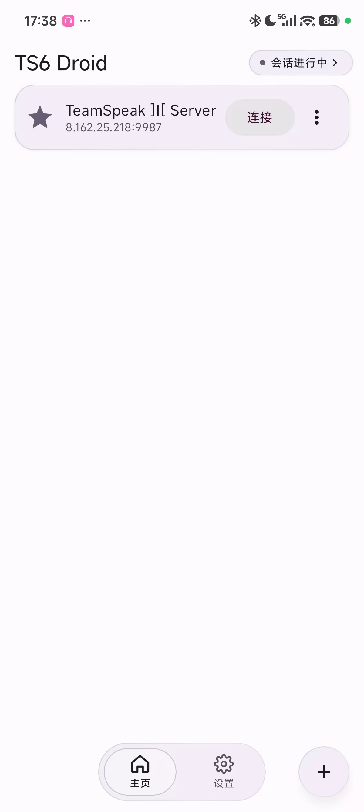
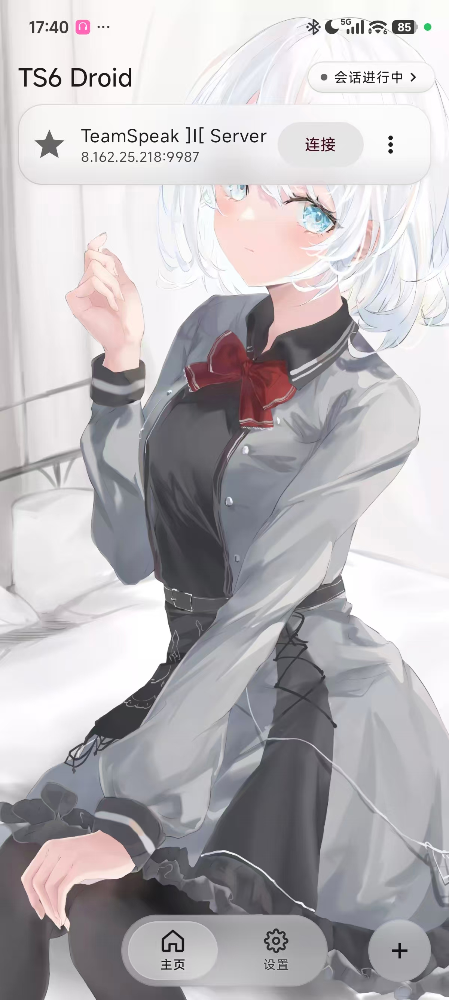
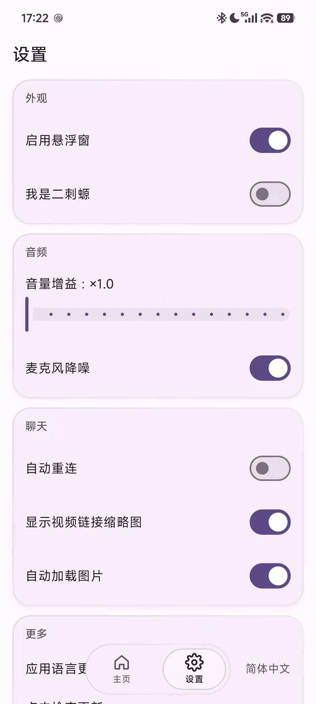
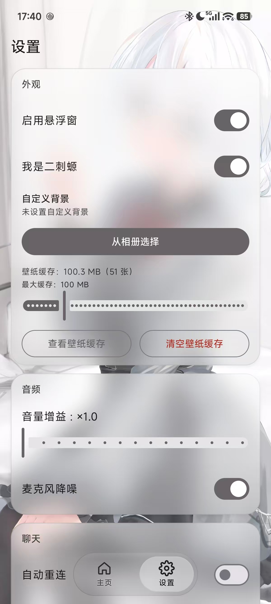
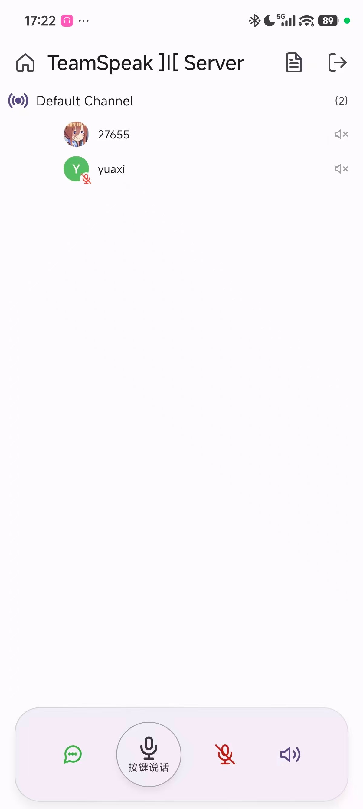
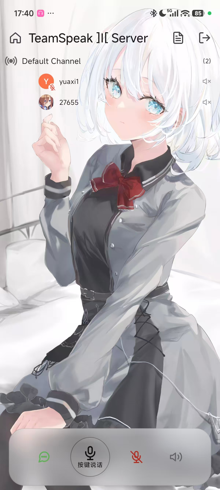
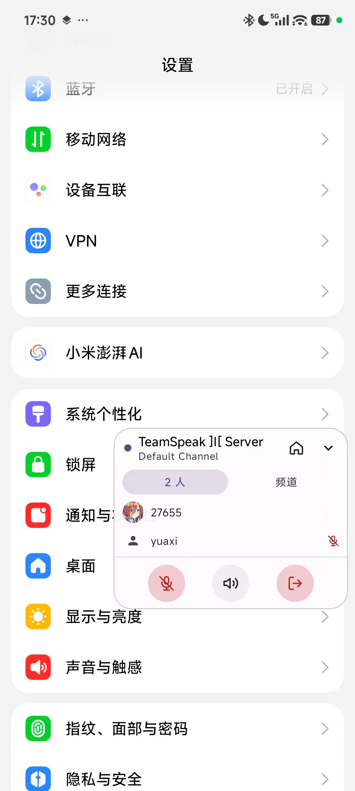
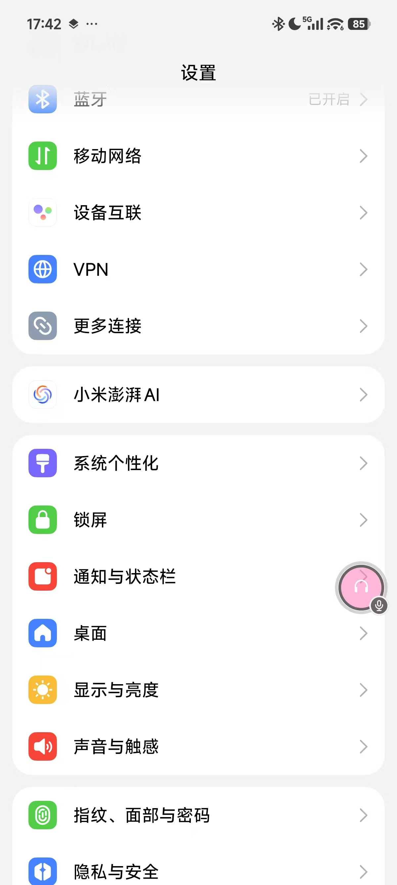

# TS6 Droid 简中版

基于原作者 [flamme-demon/TS6_Droid](https://github.com/flamme-demon/TS6_Droid) 的开源项目进行汉化与功能增强的 Android 客户端。

这是一个自由、轻量级的 TeamSpeak 3/6 安卓客户端，使用 Jetpack Compose 构建，底层由 Rust 编写的 `tslib` 驱动。

---

## 项目演示

<div align="center">
<table>
  <tr>
    <td align="center"><a href="img/screenshow1.jpg"></a></td>
    <td align="center"><a href="img/screenshow2.jpg"></a></td>
  </tr>
  <tr>
    <td colspan="2" align="center"><sub>主页（关闭 / 开启动漫背景）</sub></td>
  </tr>
  <tr>
    <td align="center"><a href="img/screenshow3.jpg"></a></td>
    <td align="center"><a href="img/screenshow4.jpg"></a></td>
  </tr>
  <tr>
    <td colspan="2" align="center"><sub>设置（关闭 / 开启动漫背景）</sub></td>
  </tr>
  <tr>
    <td align="center"><a href="img/screenshow5.jpg"></a></td>
    <td align="center"><a href="img/screenshow6.jpg"></a></td>
  </tr>
  <tr>
    <td colspan="2" align="center"><sub>服务器（关闭 / 开启动漫背景）</sub></td>
  </tr>
  <tr>
    <td align="center"><a href="img/screenshow7.jpg"></a></td>
    <td align="center"><a href="img/screenshow8.jpg"></a></td>
  </tr>
  <tr>
    <td colspan="2" align="center"><sub>悬浮窗（展开 / 收起）</sub></td>
  </tr>
</table>
</div>

<sub>每行两张为同一界面的左右对照；点击任意一张可查看原始大图。</sub>

---

## 更新日志

### v2.1.6-Han（2026-10-17）

> 本次更新参考了 [wslinnn/TS6_Droid_CN](https://github.com/wslinnn/TS6_Droid_CN) 的项目。

**安装包体积：71.7 MB → 14.9 MB**
- 开启 R8 代码压缩与资源收缩，并归档 `mapping.txt` 以便还原混淆后的崩溃栈。此前 release 包从未跑过 R8，约 11 400 个用不到的 Material 图标类被一并打进包里（dex 58.3 MB → 3.2 MB）。

**安全与隐私**
- **附件频道校验**：`ts3file://` 链接里的 `channel` 参数直接取自消息文本。此前他人只要发一条构造过的消息，就能让客户端去拉取**任意频道**的文件；现在会先校验该频道是否存在。
- **内联图片受开关约束**：聊天里的 `[img]`/图片链接此前**绕过**「自动加载图片」设置无条件加载，会把本机 IP 暴露给发送者指定的服务器；现在遵守该开关（默认关闭），改为点击加载。
- 分享链接参数改为 URL 编码（文件名含中文、空格、`&` 等不再失效）
- 同名文件在不同频道间不再串用缓存
- 过滤系统提示时不再误吞包含相同字样的用户消息
- **云备份 / 换机迁移**排除书签（含明文服务器密码）与聊天记录；此前只排除了身份私钥
- **签名口令不再写进构建脚本**：改从环境变量或本地 `keystore.properties` 读取（见[编译签名说明](#多电脑编译签名说明)）

**稳定性**
- 聊天列表同毫秒消息不再因 LazyColumn key 重复而崩溃
- 文件上传改为**先判大小再读取**，超过 10 MB 直接提示，不再把大文件整个读进内存导致 OOM
- 聊天记录改用 `org.json` 解析：此前手写扫描器遇到含 `\"` 的文本会**静默丢弃该条及其后全部历史**
- 消息被服务器拒绝时才从本地撤回（此前任意命令失败都可能误删已发送成功的消息）
- 说话状态不再永久卡死；连接瞬间到达的消息不再丢失
- 头像下载、图片预览解码、文件上传读取移出主线程；删除 PermCheck 调试日志刷屏
- 服务器以分块方式传输安装包时（无法获知总大小），更新进度不再错误地停在 100%

**语音**
- **语音激活麦克风**：麦克风模式升级为「按住说话 / 语音激活 / 开放麦克风」三选一，语音激活支持 −70 ~ −15 dB 阈值，内置迟滞、松手延迟与预发送缓冲（不吞词头词尾）
- **麦克风增益 0 ~ 400%**（0% 即关麦），解决「对方听我声音小」
- **每用户音量**：长按成员打开面板，可单独调整音量、静音、发私信，按 UID 持久化跨会话生效
- **音频焦点与回声消除**：来电、导航播报等独占音频时自动让位（可 duck 时降到 30%），结束后自动恢复，无需重连；设备支持时自动挂载 AEC，外放不再让对方听到回声
- 输出增益加软限幅，开增益不再硬削波
- 播放静默期唤醒 50 次/秒 → 4 次/秒，降低空转耗电，且不影响起播延迟
- 低延迟语音轨在部分设备初始化失败时自动去掉 `PERFORMANCE_MODE` 重建，不再无声

**网络**
- **WiFi / 蜂窝切换立即重连**：此前要等心跳超时（数秒静默）；现在平台一报告新网络就立刻重连，首次尝试不等待退避。补齐了 `ACCESS_NETWORK_STATE` 权限（缺它回调根本不会送达）

**功能**
- **身份导出 / 导入**（设置 → 身份）：可查看身份 UID、导出 `identity.ini`、导入他人身份。导入前先校验再原子替换，失败不影响现有身份。**这是换机时保住服务器权限的唯一途径**（身份私钥已从云备份中排除）
- **私聊按 UID 归档**：会话以对方 UID 归档，重连后不再把同一个人拆成多个会话标签；未读角标随聊天记录持久化，旧数据自动迁移
- **服务器信息卡**：服务器页顶栏信息按钮，查看服务器名、平台/版本、在线人数、频道数、运行时长与欢迎语
- **崩溃报告浮层**：异常退出后下次启动展示堆栈，支持一键复制（无 adb 也能排障）
- **应用内日志查看器**（设置 → 更多 → 诊断日志）：读取本应用进程日志（含原生 `tslib` 输出），支持刷新 / 一键复制 / 清空
- 更新说明改为 Markdown 渲染
- **磨砂材质补全**：长按成员弹出的面板此前使用 Material `ModalBottomSheet`（独立窗口，没有壁纸可模糊，只能是实心板），现改用应用内绘制的磨砂面板，并保留下拉关闭手势
- `AppIcons` 新增 `Info`、`Server` 图标；首页服务器列表改用新的服务器图标
- **首页不再显示服务器地址**：避免截图时泄露服务器 IP / 域名

**工程**
- 新增 **46 项单元测试**，CI 编译前自动运行
- 新增签名发布工作流：推送 `vX.Y.Z-Han` 标签后自动校验版本号、跑测试、用仓库 Secrets 签名打包、校验 APK 签名、归档 `mapping.txt`、计算 SHA-256 并创建 Release
- 关闭 Jetifier，移除重复权限声明
- 文件大小单位改为本地化（此前硬编码法语 `Ko/Mo/Go`）

### v2.1.5-Han（2026-10-15）

**磨砂材质**
- 卡片、底栏、弹窗、菜单与输入面板统一为磨砂材质，全部在界面内绘制（新增 `GlassDialog` / `GlassOverlayHost` / `GlassMenuItem` / `CompactTopBar`）
- 磨砂改为按壁纸烘焙一张模糊副本供所有面板共享，移除旧的折射（SDF）管线
- 磨砂层在绘制阶段按面板尺寸裁切，面板尺寸与位置始终一致
- 关闭动漫背景时回退为实体表面
- 顶栏统一为紧凑顶栏（64dp → 48dp）
- 「我是二刺螈」（动漫背景）默认关闭

**自绘图标集**
- 新增 `AppIcons`（24×24 视口、2 单位圆头描边，共 10 个图标），替换界面里零散的 Material 图标

**界面调整**
- 关于页改为纯白背景并锁定浅色方案
- 设置页「关于软件」移到「更多」分组末尾
- 移除密聊功能

**新功能**
- **悬浮窗重做**：仅在 App 退到后台时显示，回到前台自动隐藏
  - 气泡显示 App 图标或说话者头像，可拖动并吸附屏幕边缘，长按按住说话，右下角显示未读 / 静音角标
  - 面板含「成员 / 频道」两个视图、麦克风与声音控制、断开连接，头部 ⌂ 回到 App，展开 / 收起带过渡动画
- **左右滑动切换界面**：主页 ↔ 设置，聊天面板 频道 ↔ 私信
- **退回首页不必断开**：连接后按返回键或顶栏首页图标即可回首页，顶栏右侧「会话进行中」胶囊一键回到会话
- **壁纸缓存导出到相册**：单张保存或全部保存
- **按住说话 / 语音激活模式持久化**
- **断线自动重连**：指数退避重连，成功后回到原频道
- 设置页新增「电池优化白名单」与「应用权限与自启动」
- 麦克风不可用时在服务器页横幅、悬浮窗与通知中提示
- 新增中 / 英 / 法三语文案

**性能优化**
- 冷启动壁纸只下载并解码一次，主题主色统计改用 `getPixels`，磨砂烘焙复用缓冲
- 语言设置后台预读，图标解码与身份文件读写移出主线程，通知渠道按需创建
- 壁纸就绪耗时打印到日志

**Bug 修复**
- 修复开关壁纸卡顿
- 修复悬浮窗拖动、点击或展开时的闪退
- 修复悬浮窗展开动画过慢、徽标被裁切、按钮外出现灰色方块
- 修复聊天气泡宽度与左右分侧
- 修复关闭动漫背景后卡片只剩描边
- 修复电池优化白名单行样式不统一
- 修复启动页在壁纸就绪前进入
- 修复后台麦克风失效时自动重建录音通道
- 修复后台长时间运行后彻底没声音（采集协程改由音频桥持有）
- 连接期间持有 `PARTIAL_WAKE_LOCK`，并新增麦克风看门狗

### v2.1.4-Han（2026-08-18）

**Bug 修复**
- **昵称长度验证**：连接服务器时增加昵称最小长度检查，昵称至少需要 3 个字符（PR #4 from IMito-iron）
- 提取 `getValidatedConnectionInput()` 方法统一处理连接前的输入验证
- 新增错误提示：「昵称至少需要3个字符」（支持中/英/法三语）

### v2.1.3-Han（2026-07-28）

**新功能**
- **TS3 Spacer 频道渲染**：解析 `[cspacer]`、`[lspacer]`、`[rspacer]`、`[*spacer]` 标签，频道列表正确显示分隔线和装饰文本（PR #3 from XuVIIJay）

### v2.1.2-Han（2026-07-15）

**新功能**
- **自定义背景**：支持从相册上传图片作为背景，支持裁切预览（双指缩放 + 单指拖动）
- 裁切界面全屏预览，九宫格辅助线，四角拖动手柄
- 设置页增加自定义背景管理（上传/删除）
- 保存自定义背景后立即生效，无需重启

**UI 重构**
- 设置页重新分组为卡片式布局：外观、音频、聊天、更多
- 动漫背景开关下展开子区域（自定义背景 + 壁纸缓存）
- 语言切换和关于软件归入「更多」分组
- 版本号显示在设置页底部
- 设置页卡片半透明，不遮挡动漫背景

**Bug 修复**
- 修复裁切功能无法使用（裁切框只能移动不能缩放）
- 修复保存自定义背景后需重启才生效的问题

### v2.1.0-Han（2026-06-27）

**新功能**
- **应用内更新**：点击更新检测后可直接在应用内下载并安装 APK，无需跳转浏览器
- 下载进度条实时显示百分比，下载完成自动弹出系统安装界面
- 新增「正在下载」状态，下载中不可关闭弹窗，失败显示错误信息
- 新增 FileProvider 支持，Android 8+ 设备正常安装应用内下载的 APK
- 新增 `REQUEST_INSTALL_PACKAGES` 权限声明

**Bug 修复**
- 修复版本检测无法识别新版问题：比较版本号前先清除 `-Han` 后缀
- 修复 API 请求失败时误判为「已是最新版本」，现在显示具体错误信息
- 修复 Release 未上传 APK 时直接崩溃，现回退至 Releases 页面

**编译签名**
- 新增统一签名文件 `release.keystore`，debug 和 release 均使用同一签名
- 多电脑协作只需复制 `release.keystore` 到项目根目录即可

### v2.0.5-Han（2026-06-27）

**功能修复**
- 修复音量增益滑块调节后不生效的问题，新增 Flow 观察者实时同步到音频桥
- 麦克风降噪实现验证：使用 Android 原生 NoiseSuppressor API，补全日志帮助排查设备兼容性
- Logo 背景色从蓝色更换为粉色（#2962FF → #FF69B4）
- 修复应用内版本检测无法检测到新版的问题：版本号比较前清除 `-Han` 后缀，API 失败时显示错误信息而非误判为「已是最新」
- 修复 GitHub API 在国内网络环境下不可用时长显「已是最新」的问题

**新功能**
- 应用内版本检测：设置页点击版本号可查询 GitHub 最新 Release 并弹窗更新
- 网络错误时显示具体错误信息，无更新时提示「已是最新版本」
- Release 未上传 APK 时自动回退跳转至 GitHub Releases 页面

### v2.0.1-Han（2026-06-26）

**Compose 性能优化**
- 全项目 54 处 Flow 采集从 `collectAsState` 迁移至 `collectAsStateWithLifecycle`，应用切后台时自动暂停 UI 采集，降低 CPU 占用和电量消耗
- 背景图片淡入动画从 `Modifier.alpha()` 迁移至 `Modifier.graphicsLayer {}`，动画帧跳过 Composition 阶段重组，减少掉帧
- 缓存壁纸网格添加稳定 `key`，避免增删壁纸时滚动位置跳回

**Bug 修复**
- 修复查看壁纸缓存无反应，点击后弹出缩略图网格弹窗
- 清空壁纸缓存添加二次确认弹窗
- 设置页音量增益滑块可正常调节
- 设置页开关切换页面时不再跳动闪烁
- 文件管理器点击图片文件支持应用内全屏预览

### v2.0.0-Han（2026-06-26）

**Material3 UI 全面重构**
- 采用 Google Material Design 3 规范，完全重构配色、排版与组件样式
- Dynamic Color 动态取色（Android 12+），主题色从壁纸图片自动提取并生成完整配色方案
- 15 级排版体系，Shape 圆角 token 对齐 M3 标准
- 所有组件（按钮、输入框、卡片、弹窗、底部栏）统一 M3 风格

**启动页与主题自适应**
- 新增 SplashScreen 启动界面，加载期间显示品牌标识
- 壁纸图片下载后自动提取主色调，主题配色实时适配
- 3 秒超时保护：网络异常时从缓存随机抽取壁纸作为背景

**底部导航栏 + 设置页**
- 首页新增底部导航栏（主页 + 设置），支持页面切换
- 语言切换、自动重连、音量增益、悬浮窗、动漫背景、麦克风降噪、关于软件全部整合到设置页
- 服务端不再显示设置弹窗，界面更简洁

**壁纸缓存系统**
- 壁纸图片自动缓存到本地，启动时优先使用缓存
- 可设置缓存最大容量（10MB - 500MB 滑块调节）
- 查看缓存壁纸缩略图网格，支持单张删除
- 清空缓存带二次确认弹窗
- 以上设置仅在「我是二刺螈」开启时可用

**动画背景优化**
- 壁纸切换不再闪烁：缓存机制 + 600ms 淡入动画
- 切页不再触发重新获取，全局共享同一张壁纸
- 首页空列表居中显示「暂无连接」

**文件管理器图片预览**
- 点击图片文件直接在应用内全屏预览，不再弹出外部打开方式

**Bug 修复**
- 修复 Config#HARDWARE bitmap 无法 getPixel 导致闪退
- 修复设置页开关在页面切换时跳动闪烁
- 修复 SettingsDialog 残留代码导致编译错误
- 修复窗口背景色导致的灰色底色问题
- 统一所有组件使用 M3 颜色 token

---

## 汉化及增强特性

1. **简体中文本地化**：100% 补齐全文本简体中文翻译（`zh-rCN`）。
2. **语言切换**：支持中文、English、Français 一键切换，无需更改手机系统语言。
3. **内置核心语音驱动**：直接内置核心二进制库（`jniLibs`，当前仅随包提供 arm64-v8a），开箱即用。
4. **精简安装包**：release 构建开启 R8 代码压缩与资源收缩，安装包约 **15 MB**（未压缩时约 72 MB）。
5. **CI/CD**：云端编译并运行单元测试；推送版本标签后自动签名打包并发布 Release。
6. **统一的磨砂材质与自绘图标**：卡片、浮动底栏、弹窗、菜单、成员面板与底部面板是同一套「就地绘制」的半透明磨砂表面，跟随系统深浅色；关闭动漫背景时自动回退为实体表面。界面图标统一为自绘图标集 `AppIcons`，不再混用 Material 图标。
7. **动漫背景与自定义背景**（默认关闭）：开启后可获取在线动漫壁纸并自动提取主色生成主题，也可从相册选择图片（支持裁切预览）；壁纸缓存可设上限、浏览、单张删除，并可**导出到相册**。
8. **后台悬浮窗**：连接后 App 退到后台会出现悬浮气泡（有人说话时显示说话者头像，否则显示 App 图标），可拖动并吸附屏幕边缘；轻点展开面板查看当前频道成员、切换频道、控制麦克风/声音、断开连接；长按气泡可**按住说话**，头部 ⌂ 一键回到 App。
9. **断线自动重连与后台保活**：掉线后指数退避自动重连并回到原频道，WiFi / 蜂窝切换时立即重连；提供电池优化白名单与应用详情快捷入口；连接期间持有 wake lock，并有麦克风看门狗自愈。
10. **语音控制**：麦克风模式支持「按住说话 / 语音激活 / 开放麦克风」，语音激活可调阈值；麦克风增益 0 ~ 400%，输出增益 0 ~ 800% 并带软限幅；支持按成员单独调整音量与静音（按 UID 持久化）。
11. **音频焦点与回声消除**：来电、导航播报等独占音频时自动让位并自动恢复，无需重连；设备支持时自动启用 AEC。
12. **身份导出 / 导入**：设置页可查看身份 UID，导出 / 导入 `identity.ini`，换机时可保住服务器权限。
13. **服务器信息卡**：查看服务器名、平台 / 版本、在线人数、频道数、运行时长与欢迎语。
14. **文件管理器**：浏览 / 下载 / 上传 / 新建 / 重命名 / 删除 / 分享，图片可在应用内全屏预览。
15. **应用内更新**：检查更新后直接在应用内下载并安装 APK，更新说明支持 Markdown。
16. **排障能力**：崩溃报告浮层（下次启动展示堆栈并一键复制）与应用内日志查看器（设置 → 更多 → 诊断日志）。

---

## 多电脑编译签名说明

本项目使用 `release.keystore` 签名文件，确保各机器编译的 APK 签名一致，覆盖安装时不报签名冲突。

**仓库中不保存任何签名口令。** 构建脚本按以下顺序读取签名参数，两者都没有时回退为 debug 签名（本地开发不受影响）：

1. 环境变量 `SIGNING_KEYSTORE_FILE`、`SIGNING_STORE_PASSWORD`、`SIGNING_KEY_ALIAS`、`SIGNING_KEY_PASSWORD`（CI 使用，见下）
2. 项目根目录的 `keystore.properties`（本地使用，已被 `.gitignore` 排除）：

```properties
storePassword=你的密钥库口令
keyAlias=ts6droid
keyPassword=你的密钥口令
```

签名文件本身也已被 `.gitignore` 排除，不会提交到 GitHub；多电脑协作时，把 `release.keystore` 与 `keystore.properties` 复制到对应位置即可。

### 生成新的签名文件

如需替换签名（例如用于正式发布），在项目根目录执行：

```bash
keytool -genkey -v -keystore release.keystore -alias ts6droid -keyalg RSA -keysize 2048 -validity 10000
```

> ⚠️ 签名密钥等同应用身份：**请勿把 `release.keystore` 或口令提交到仓库或公开渠道**。一旦泄露，他人可以签出与你的应用同签名的安装包。

---

## 如何进行云编译 (GitHub Actions)

**默认分支推送 / 手动触发**：自动编译并运行单元测试，产出 `app-debug.apk`（未混淆，体积较大）供调试，可在 Actions 页面的 **Artifacts** 下载。

**正式发布**：推送形如 `v2.1.6-Han` 的标签后，[android-release.yml](.github/workflows/android-release.yml) 会自动：

1. 校验标签与应用版本号一致（防止忘记改版本号导致应用内检测更新出错）
2. 运行单元测试
3. 用仓库 Secrets 中的证书签名打包 release APK
4. 校验 APK 签名并在 Actions 日志打印证书指纹
5. 归档 `mapping.txt`（混淆后崩溃栈还原行号所需）
6. 计算 SHA-256 并创建 GitHub Release

需要在仓库 **Settings → Secrets and variables → Actions** 中配置：`SIGNING_KEYSTORE_BASE64`（密钥库的 Base64 编码）、`SIGNING_STORE_PASSWORD`、`SIGNING_KEY_ALIAS`、`SIGNING_KEY_PASSWORD`。

---

## 技术架构与配置

关于底层 Rust 架构、本地编译环境搭建等技术细节，请参考原作者仓库：

[flamme-demon/TS6_Droid](https://github.com/flamme-demon/TS6_Droid)

---

## 开源许可

本项目遵循 GNU GPLv3 开源许可证。详见 [LICENSE](LICENSE) 文件。

---

## 贡献者

感谢所有为本项目做出贡献的开发者！

<a href="https://github.com/YUAXI/TS6_Droid_CN/graphs/contributors">
  
</a>
